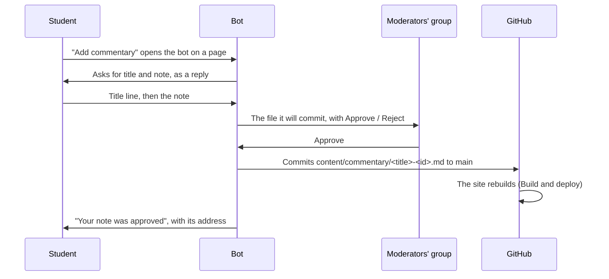

# Commentary

Notes by older students that connect posts and articles, and questions answered by moderators. They're files in `content/commentary/`, written through the [Telegram bot](telegram-bot.md).

## A note

```yaml
---
title: "The note's title"
author: "Their Telegram name"
date: 2026-11-12
connects:
  - "/vol_iii/462493170453287_536381629731107/"
---

The note. [[Another note's title]] links to it, as in Obsidian.
```

- **Links:** `[[Note title]]`, `[[/site/path/]]` and `[[target|label]]` work as in Obsidian, so `content/commentary/` is itself an Obsidian vault.
- **Questions** have `question: true`, and once answered `answer` and `answered_by`. The page shows the question, then the answer.

## On the site

- **The COMMENTARY panel** under posts, comments and articles lists the notes connecting to that page. A sidebar switch shows it; it's off by default.
- **`/commentary/`** has a connections map drawn with d3 (loaded from cdnjs; see [Hosting and outside services](../hosting.md)) and the list of notes.
- **"Add commentary" and "Ask a question"** open the bot on that page. With `commentary_telegram = false` in `config.toml`, "Add commentary" opens GitHub's editor with a prefilled note instead.
- **Where the links are worked out:** `partials/commentary.html` works out every note's links and backlinks once per build.

## How a note gets in



## Connected

- [Telegram bot](telegram-bot.md): how notes arrive.
- [Build and deploy](build-and-deploy.md): each approved note triggers a deploy.
- [Search and SEO](search-and-seo.md): notes are searchable with the Commentary filter.

Details: `CLAUDE.md`, "Commentary".
