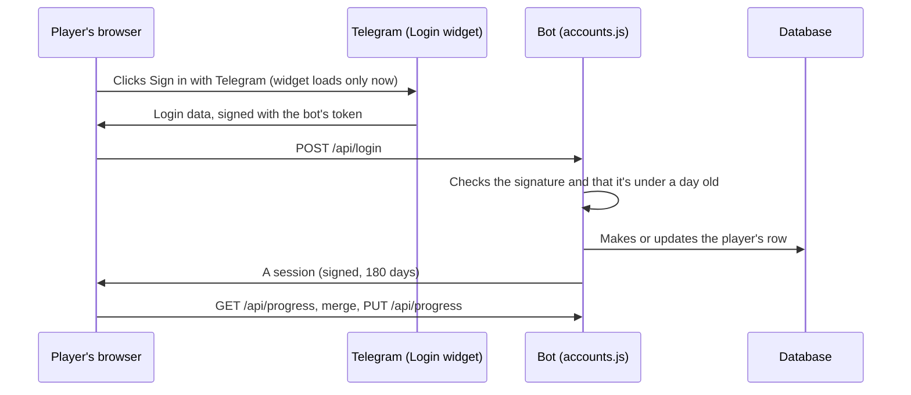

# Flash card accounts

Players of the [Flash cards](flash-cards.md) can sign in with Telegram, so their progress follows them to every device, and ask the bot to remind them when they haven't practised. **It's built but switched off.** It turns on when `flashcards_accounts` in `config.toml` holds the bot's address, after the setup in `telegram-bot/README.md`, "Flash card accounts".

## Signing in

## Keeping two devices in step

- **The browser owns the progress.** It merges its copy with the account's: each card keeps the record with more answers, each deck the better best score, and where the decks are comes from the copy changed last.
- **Every save names the revision it was merged with.** If another device saved in between, the bot refuses (409) and sends back its copy; the browser merges again and resaves. Neither device overwrites the other.
- **Forget my progress** stamps the time, so copies older than it count as empty, on every device.

## What's kept, and how it goes

- **What's kept:** each player's Telegram ID, first name, progress, when they last saved, whether they want reminders, and when the last one was sent (`telegram-bot/schema.sql`). The page says so beside the button.
- **Reminders** are opt in. One goes out after two days without practice, and no other until they play again. `/stop` in the bot turns them off, and a player who blocks the bot is taken off.
- **Deleting:** `/delete` in the bot deletes the player's row. Forget my progress erases only the progress.

## Where it runs

- **The host:** whatever runs the [Telegram bot](telegram-bot.md). On Cloudflare, a D1 database and a cron trigger. On your own machine, a SQLite file and a timer.
- **Neither is set up yet.** See [Hosting and outside services](../hosting.md).

## Files

| | |
|---|---|
| The API, reminders, `/stop`, `/delete` | `telegram-bot/accounts.js` |
| The sign-in panel | `layouts/_default/flashcards.html` (shown only with `flashcards_accounts` set) |
| Merging and saving | `static/js/flashcards.js` (the Accounts section) |
| Tests | `telegram-bot/test-accounts.mjs`, `test-server.mjs` |

Details: `telegram-bot/README.md`, "Flash card accounts"; [Writing flash card decks](../flashcards.md), "Players' progress".
