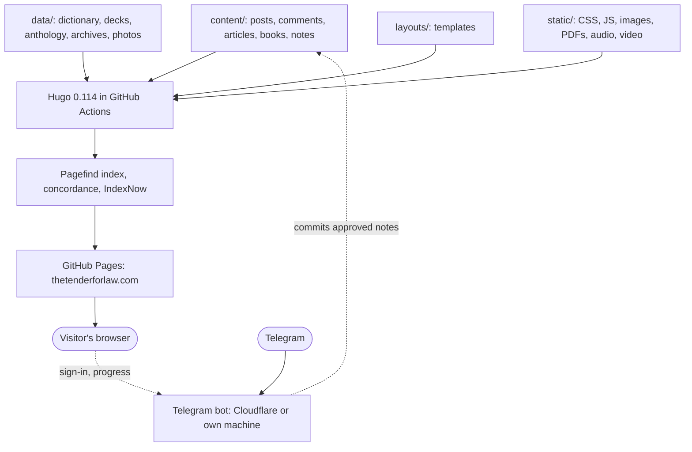

# Overview

The Tender For Law is an archive of a Facebook group (2013 to 2018), with articles by its members, a library of the books behind them, and learning tools. It is a **static site**: Hugo turns the files in this repository into plain HTML, CSS and JavaScript, and GitHub Pages serves them at https://thetenderforlaw.com/. There is no server behind the pages. The one part that needs a running program, the Telegram bot, lives apart from the site.

## The flow

1. **Content and data** are files: the archive's posts and comments as JSON front matter, articles and books as Markdown, and lists such as the dictionary and the flash card decks as JSON or YAML. See [Content model](content-model.md).
2. **Templates** in `layouts/` turn them into pages, choosing the layout by the shape of each file's data. See [Templates](templates.md).
3. **Every push to `main` rebuilds the whole site** in GitHub Actions and publishes it. The build also writes the search index and the concordance, and tells search engines what changed. See [Build and deploy](build-and-deploy.md).
4. **In the browser**, small scripts in `static/js/` add the interactive parts: search filters, inline definitions, the flash card game, the carousel and the theme animations. See [Design and themes](design-and-themes.md).
5. **The Telegram bot** takes students' notes and questions, has moderators approve them, and commits them to the repository, which rebuilds the site. It also keeps flash card accounts. See [Telegram bot](telegram-bot.md) and [Hosting and outside services](../hosting.md).

## The parts

- What the archive holds and how it's laid out: [Content model](content-model.md), [Templates](templates.md).
- Finding things: [Search and SEO](search-and-seo.md), [Dictionary and concordance](dictionary-and-concordance.md).
- Learning: [Library](library.md), [Flash cards](flash-cards.md), [Flash card accounts](flash-card-accounts.md).
- Contributions: [Commentary](commentary.md), [Telegram bot](telegram-bot.md).
- Restoring the record: [Anthology](anthology.md), [Recovered records](recovered-records.md).
- Look and feel: [Design and themes](design-and-themes.md).
- Helpers: [Scripts](scripts.md).

## Ground rules

- **The record is never edited.** Exported posts and comments render as they were. Anything the site adds (archived links, recovered pictures, printout copies, names from the printout) is labelled as added by this site.
- **Hugo 0.114 is the version that counts:** the deploy pins it, so templates must work there even if a newer Hugo runs locally.
- **No `public/` is kept:** it's rebuilt for every deploy. A full build writes about 256,000 files.
- **Outside services are listed** in [Hosting and outside services](../hosting.md), and the bot's logic stays free of any one host.
