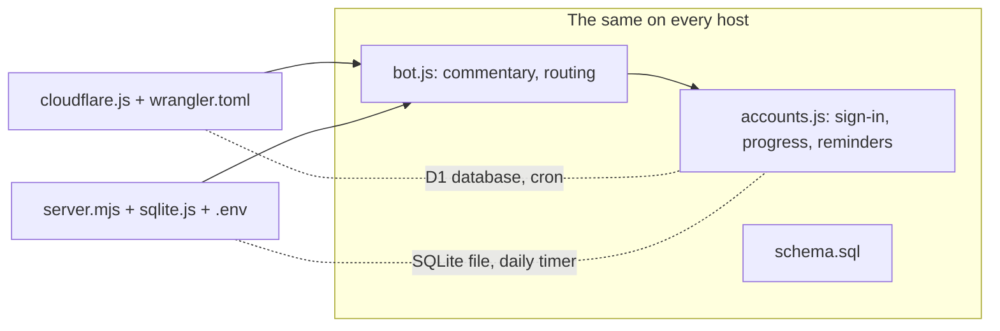

# Telegram bot

**@CommentaryTTFLbot** is the one part of the site that runs as a program. GitHub Pages only serves files, so the bot runs elsewhere: today on Cloudflare, or on a machine of your own. It does two jobs: [Commentary](commentary.md) (notes and questions) and [Flash card accounts](flash-card-accounts.md).

## Built to move

| File | Job |
|---|---|
| `telegram-bot/bot.js` | The bot's logic. Takes standard web requests and returns responses, with no host-specific code |
| `telegram-bot/accounts.js` | The flash card accounts' API, `/stop` and `/delete`, and the daily reminders |
| `telegram-bot/schema.sql` | The accounts table |
| `telegram-bot/cloudflare.js`, `wrangler.toml` | Runs it as a Cloudflare Worker |
| `telegram-bot/server.mjs`, `sqlite.js`, `.env.example` | Runs it on any machine with Node 22.5 or newer |
| `telegram-bot/test.mjs`, `test-accounts.mjs`, `test-server.mjs` | `npm test` in that folder |

## What reaches it

- **From Telegram (the webhook):** every message and button press, checked against `WEBHOOK_SECRET`:
  - in private chats, notes, questions, `/ask`, `/stop` and `/delete`;
  - in the moderators' group, Approve, Reject and replies that answer questions.
- **From the site (`/api/…`):** flash card sign-in and progress. See [Flash card accounts](flash-card-accounts.md).
- **Once a day:** the reminders. On Cloudflare a cron trigger starts them; on your own machine, a timer in `server.mjs`.

## What it holds

| Setting | What it is |
|---|---|
| `TELEGRAM_TOKEN` | The bot's token, from BotFather |
| `WEBHOOK_SECRET` | Proves a request came from Telegram |
| `MOD_CHAT_ID` | The moderators' group |
| `GITHUB_TOKEN` | Lets it commit approved notes |
| `DB` / `ACCOUNTS_DB` | The accounts database (optional) |

The commentary part stores nothing: a note lives in the moderators' message until it's approved.

## Where it runs today

- **Today:** on Cloudflare, as the Worker `ttfl-commentary-bot`, last deployed 13 November 2026. The flash card accounts code isn't deployed there yet.
- **Moving it:** follow [Hosting and outside services](../hosting.md), which has the moves in both directions.

## Connected

- [Commentary](commentary.md), [Flash card accounts](flash-card-accounts.md): its two jobs.
- [Hosting and outside services](../hosting.md): where it runs and how to move it.

Details: `telegram-bot/README.md`; `CLAUDE.md`, "Commentary".
