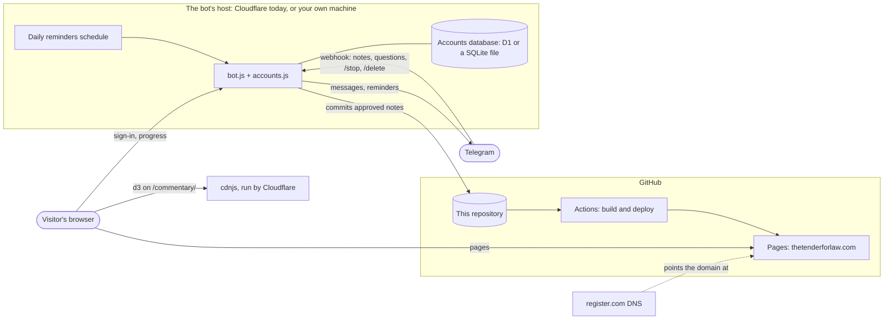

# Where the site's services run

Everything the site depends on outside this repository, with Cloudflare first: what is used today, what the flash card accounts plan would add, and how to move the bot between Cloudflare and a machine of your own. Keep this page up to date whenever a service is added, moved or dropped.

Checked on 17 November 2026.

## The picture



## Cloudflare: everything we use it for

| What | Status | Where it's set | What it does |
|---|---|---|---|
| **Worker `ttfl-commentary-bot`** | **In use**: first deployed 12 Nov 2026, last deployed 13 Nov 2026 | `telegram-bot/wrangler.toml` (`main = "cloudflare.js"`) | Runs the commentary bot: Telegram passes every message and button press to it (the webhook), and it commits approved notes and answered questions to GitHub. Its address is `https://ttfl-commentary-bot.<your account>.workers.dev` (shown by `npx wrangler deploy` and in the Cloudflare dashboard). |
| **The bot's four secrets** | **In use** | Set with `npx wrangler secret put`; held by Cloudflare, not readable back | `TELEGRAM_TOKEN`, `WEBHOOK_SECRET`, `MOD_CHAT_ID`, `GITHUB_TOKEN`. Moving hosts means supplying them again (below). |
| **cdnjs** (`cdnjs.cloudflare.com`) | **In use** | `layouts/commentary/list.html`, the `d3` script | Serves the d3 library for the connections map on `/commentary/`. Cloudflare runs cdnjs as a free public file server; no account is involved. |
| **`wrangler` login on this computer** | **In use** | `~/.config/.wrangler/` | Lets `npx wrangler …` act on your Cloudflare account. `npx wrangler logout` removes it. |
| **Daily schedule** (cron trigger) | **Planned**: in `wrangler.toml` since PR #148, but not on Cloudflare yet | `[triggers]` in `telegram-bot/wrangler.toml` | Sends flash card reminders once a day at 15:07 UTC. It reaches Cloudflare with the next `npx wrangler deploy`, and does nothing until the accounts database exists. |
| **D1 database `ttfl-accounts`** | **Planned**: not created | `[[d1_databases]]` in `telegram-bot/wrangler.toml` (commented out) | Would keep flash card accounts: each player's Telegram ID, first name, progress and reminder choice (`telegram-bot/schema.sql`). |

**Not on Cloudflare:** the site itself (GitHub Pages, built by GitHub Actions) and the domain's DNS (register.com: `dns101.register.com`, `dns102.register.com`, pointing `thetenderforlaw.com` at GitHub Pages). Nothing on the site sends visitors through Cloudflare except the d3 file on `/commentary/`.

Nothing else in the plan needs Cloudflare. Step 2 of the Telegram integration (flash card accounts) needs exactly three things from whatever host runs the bot: somewhere to run `bot.js`, a database, and a daily schedule. Both hosts below provide all three.

## Choosing the bot's host

The bot's logic is written once, in files that don't know where they run:

| File | Job | Changes with the host? |
|---|---|---|
| `telegram-bot/bot.js` | The commentary bot, and the router to the accounts | No |
| `telegram-bot/accounts.js` | Flash card accounts: sign-in check, progress, reminders, `/stop`, `/delete` | No |
| `telegram-bot/schema.sql` | The accounts table | No |
| `telegram-bot/cloudflare.js` + `wrangler.toml` | Starts it on Cloudflare: Cloudflare's secrets, D1, cron | Cloudflare only |
| `telegram-bot/server.mjs` + `sqlite.js` + `.env` | Starts it on any machine with Node 22.5 or newer: settings from `.env`, a SQLite file, a daily timer | Own machine only |

| | Cloudflare | Your own machine |
|---|---|---|
| Runs `bot.js` | Worker (`cloudflare.js`) | `node --env-file=.env server.mjs` |
| Settings | `npx wrangler secret put <NAME>` | `telegram-bot/.env` (from `.env.example`; never committed) |
| Accounts database | D1 `ttfl-accounts` | SQLite file, `ACCOUNTS_DB` (default `accounts.db`) |
| Daily reminders | `[triggers]` cron in `wrangler.toml` | Timer in `server.mjs`, `REMIND_AT_UTC` |
| HTTPS address | Given: `…workers.dev` | Yours to provide: a web server such as Caddy, and a DNS name such as `bot.thetenderforlaw.com` |
| Cost and upkeep | Free plan; Cloudflare keeps it running | Your machine must stay on, online and updated |

Only **two addresses** say where the bot is, so a move changes only those two:

1. **Telegram's webhook**: where Telegram delivers messages (`setWebhook`, below).
2. **`accounts` under `[params.telegram]` in `config.toml`**: where the flash card page sends sign-ins and progress. Leave it empty while accounts are off.

Players stay signed in across a move: their sessions are signed with a key made from the bot's token, not tied to the host.

## Moving the bot from Cloudflare to your own machine

1. **A machine and an address.** You need a machine that stays on with Node 22.5 or newer, reachable from the internet over HTTPS. A small VPS is simplest. At register.com, add an `A` record such as `bot.thetenderforlaw.com` pointing at it, and put [Caddy](https://caddyserver.com/) in front (it gets the HTTPS certificate itself), with this `Caddyfile`:

   ```
   bot.thetenderforlaw.com {
     reverse_proxy 127.0.0.1:8787
   }
   ```

   A computer at home also works if port 443 is forwarded to it, or behind a tunnel service. Cloudflare Tunnel is Cloudflare, so use another one if the aim is to leave Cloudflare.
2. **Copy the bot** (the `telegram-bot/` folder) to the machine. Copy `.env.example` to `.env` and fill in the four settings. Cloudflare can't show its secrets back, so gather them again:
   - `TELEGRAM_TOKEN`: BotFather, `/mybots`, the bot, **API Token**.
   - `MOD_CHAT_ID`: the moderators' group ID (see `telegram-bot/README.md`, step 2).
   - `GITHUB_TOKEN`: make a new fine-grained token (README step 3).
   - `WEBHOOK_SECRET`: a new random string, such as from `openssl rand -hex 32`.
3. **Bring the accounts over**, if they were on D1. Run this before starting the server:

   ```sh
   npx wrangler d1 export ttfl-accounts --remote --output accounts.sql
   sqlite3 accounts.db < accounts.sql
   ```
4. **Start it**, and test it with `curl https://bot.thetenderforlaw.com/api/progress`, which should answer `{"error":"Not signed in."}`:

   ```sh
   node --env-file=.env server.mjs
   ```

   To keep it running and restart it with the machine, use a systemd service (`/etc/systemd/system/ttfl-bot.service`, then `sudo systemctl enable --now ttfl-bot`):

   ```ini
   [Unit]
   Description=TTFL commentary bot and flash card accounts
   After=network-online.target

   [Service]
   WorkingDirectory=/opt/ttfl/telegram-bot
   ExecStart=/usr/bin/node --env-file=.env server.mjs
   Restart=always

   [Install]
   WantedBy=multi-user.target
   ```
5. **Point Telegram at it**, with the new `WEBHOOK_SECRET`:

   ```sh
   curl "https://api.telegram.org/bot<TOKEN>/setWebhook" \
     -d url=https://bot.thetenderforlaw.com \
     -d secret_token=<WEBHOOK_SECRET> \
     -d 'allowed_updates=["message","callback_query"]'
   ```
6. **Point the site at it**, if accounts are on: set `accounts = "https://bot.thetenderforlaw.com"` under `[params.telegram]` in `config.toml` and deploy.
7. **Retire the Cloudflare copy** once the new one works. `npx wrangler delete` removes the Worker and its schedule. After that, `npx wrangler d1 delete ttfl-accounts` removes the database, if you made one, and `npx wrangler logout` removes the login from this computer.

## Moving the bot to Cloudflare (from your own machine, or the first time)

1. Follow `telegram-bot/README.md`: "Setting it up" for the bot, then "Flash card accounts" for the database.
2. **Bring the accounts over**, if there are any:

   ```sh
   sqlite3 accounts.db .dump > accounts.sql
   npx wrangler d1 execute ttfl-accounts --remote --file accounts.sql
   ```

   D1 refuses `BEGIN TRANSACTION` and `COMMIT`, so delete those two lines from `accounts.sql` first.
3. Point Telegram's webhook and `accounts` (`[params.telegram]`) at the `…workers.dev` address, as in steps 5 and 6 above.
4. Stop the old server: `sudo systemctl disable --now ttfl-bot`.

## The d3 file from cdnjs

`/commentary/` loads d3 from Cloudflare's cdnjs. To serve it from the site instead, with no outside request:

1. Download `https://cdnjs.cloudflare.com/ajax/libs/d3/7.9.0/d3.min.js` into `static/js/vendor/d3.min.js`. d3 is ISC-licensed; keep its licence comment at the top.
2. In `layouts/commentary/list.html`, change the script's `src` to `{{ "js/vendor/d3.min.js" | relURL }}`.

## Other outside services

None of these is Cloudflare. They're listed so the whole picture is in one place.

| Service | Used for | Where |
|---|---|---|
| GitHub (Pages, Actions) | Hosting and building the site | `.github/workflows/hugo.yml` |
| register.com | The domain and its DNS | register.com account |
| Telegram | The bot; the Login widget on the flash card page (`telegram.org`, loaded only when a player clicks Sign in) | `telegram-bot/`, `static/js/flashcards.js` |
| GitHub API | The bot commits approved notes | `telegram-bot/bot.js`, `GITHUB_TOKEN` |
| jsDelivr (`cdn.jsdelivr.net`) | three.js and its hexagon grid (Sepia carousel); Webamp | `static/js/carousel-shaders.js`, `static/js/webamp-links.js` |
| unpkg (`unpkg.com`) | Webamp, for the sidebar's dock: **off** (`[params.webamp_dock]` in `config.toml`) | `static/js/webamp-dock.js` |
| comments.app | Telegram comments on the home page: **off** (`[params.comments_app]` `website` is empty) | `layouts/index.html` |
| YouTube (`youtube-nocookie.com`, `i.ytimg.com`) | Videos in posts, loaded on click | `partials/youtube-embeds.html`, `static/js/youtube-embed.js` |
| npm registry | Pagefind, fetched by `npx` at each deploy | `.github/workflows/hugo.yml` |
| IndexNow (`api.indexnow.org`) | Tells search engines about changed pages after each deploy | `scripts/indexnow.py`, `.github/workflows/hugo.yml` |
| Wayback Machine, archive.today | Archived links (run by hand, not at deploy) | `scripts/archive_links.py` |

## Related notes

[The bot](architecture/telegram-bot.md) · [Flash card accounts](architecture/flash-card-accounts.md) · [Build and deploy](architecture/build-and-deploy.md) · [The map](README.md)
